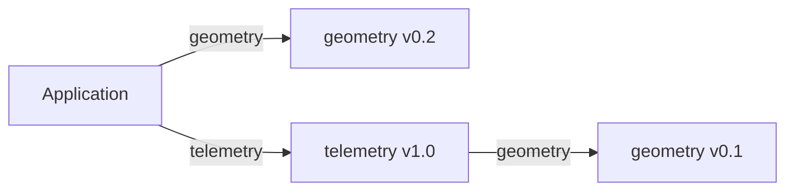

# Native package workflow

Status: package-local dependency scopes accepted. The first N3-A slice now
implements an [explicit scoped offline graph API](scoped-package-resolution.md).
[Library manifests](native-library-manifests.md) now validate package metadata,
public entries and optional example applications, and construct scoped nodes.
An [exact-commit local Git snapshot API](native-git-snapshots.md) now supplies the
first N3-B foundation, including integrity and exclusive publication.
The first [public installer](native-package-install.md) now activates complete
exact-commit graphs for compiler/checker and Metal source builds.
[Public HTTPS transport](native-remote-git.md) now extends the local snapshot path.
[Public locks](native-package-lock.md) support frozen reinstalls and cache-only
offline installation. [Branch/tag resolution](native-git-refs.md) now preserves
owner-local pins. Authenticated/SSH transport remains planned. Existing standalone
local mapping workflows retain their behavior.

The first native package workflow should support Git libraries, transitive
source dependencies, a reproducible lockfile and offline builds. It should use
ordinary imports and the existing type/ownership rules. A public registry and
SemVer range solver are not prerequisites for that first implementation.

## Application and library manifests

An application keeps its existing entry and names the libraries it uses:

```toml
format = 1

[project]
entry = "src/main.k"

[dependencies]
geometry = { git = "https://example.com/team/geometry.git", rev = "v0.2.0" }
telemetry = { git = "https://example.com/team/telemetry.git", rev = "v1.0.0" }
```

These URLs are illustrative. A library supplies a public source entry:

```toml
format = 1

[package]
name = "geometry"
version = "0.2.0"
entry = "src/public.k"
```

The `[package]` and `[dependencies]` tables now extend the native manifest;
currently dependency requests accept canonical absolute local repository paths
or supported HTTP(S) URLs with exact commits or supported branch/tag names.
See [revision naming and ambiguity](native-git-refs.md) for the implemented rules. A library can also have a
`[project]` entry for an example executable. At least one entry is required;
`[package].entry` is selected when another package imports the library, while
`[project].entry` is selected when compiling its application. Public entries use
ordinary exports and explicit re-exports; they introduce no initialization code.

Dependency keys are local import aliases, following current package-name rules.
The alias need not match the library's declared name. `version` is valid SemVer
metadata, including prereleases; it does not override the resolved Git identity
or imply that a range solver exists. A Git ref and a metadata version are not
assumed to be equivalent merely because their strings resemble each other.

`rev` selects a supported tag, branch or exact commit. Mutable names resolve to
exact commits during installation and remain fixed by the lockfile afterward. Ref
validation and branch/tag ambiguity must have explicit, tested rules; ambiguous
selection should fail rather than silently prefer an unrelated ref.

Source code stays simple:

```kalandra
from "geometry" import Point
from "telemetry" import record
```

No version, cache directory or Git URL appears in a source import. Initially,
package manifests live at repository roots. Monorepo subdirectory packages,
workspace dependency declarations and registry coordinates are later additions.
Existing explicit local `[packages]` mappings remain available for local work.
An alias declared in both `[packages]` and `[dependencies]` is an error.

## Dependencies have their own import scope

A library resolves its imports through **its own** manifest, not its caller's.
The compiler must not flatten all installed dependencies into one global alias
table. For example, telemetry can depend on geometry v0.1 while the application
uses geometry v0.2:



Each `geometry` import resolves locally. Two dependencies with the same alias
are therefore not a conflict unless they are declared in the same scope.

This also determines type identity. Records/enums from different resolved
package identities are distinct nominal types, even if both are named `Point`
and have the same fields. A telemetry function accepting its geometry-v0.1
`Point` cannot silently accept the application's geometry-v0.2 `Point`.
Primitive values still obey their ordinary language rules. An application can
alias imports or construct an explicit adapter when it intentionally crosses
that boundary. Library authors can avoid exposing a dependency's nominal types
when they want callers to remain independent of that dependency.

Two aliases for the same resolved package share declarations and nominal types.
Resolved identity includes the normalized source repository and exact commit;
metadata name/version alone never merges different repositories or commits.
A shared package node must have one consistent set of locked dependency edges.
There are no caller-supplied dependency overrides in this first workflow.

The module loader needs a package-owner context, not only a canonical file path.
Within one owner, relative imports and aliases still share one canonical module
identity, preserving current diamond behavior. Managed library relative imports
must remain within its source snapshot; they cannot reach arbitrary application
or cache files. The workspace's existing explicit local-file behavior remains
separate. Cyclic source imports remain errors. Dependency cycles are also rejected
initially, rather than introducing recursive resolution environments.

## Installation and the lockfile

The public workflow below is implemented for exact commits and supported
branch/tag requests:

```sh
kalandra install --project my-app/kalandra.toml
kalandra install --project my-app/kalandra.toml --frozen
kalandra install --project my-app/kalandra.toml --offline
kalandra --project my-app/kalandra.toml -o my-app/program
```

`install` is explicit and does not rewrite source or the project manifest.
Compilation, checking, formatting and editor analysis never fetch dependencies.
The existing explicit-manifest rule is retained; this proposal does not add
ancestor discovery or an implicit current-directory project.

`kalandra.lock` lives beside the manifest and records the root dependency
requests, exact resolved commits, dependency edges, public entries and integrity
hashes for immutable source snapshots. It contains portable source identities,
not machine-specific absolute cache paths. Commit it with the application.
Unknown lock formats, mismatched declarations, inconsistent edges and malformed
or out-of-bounds paths fail clearly; no partial graph is accepted.

Installation reuses locked commits for unchanged owner-local requests even when
a tag/branch moves. It checks
locked digests, public entries and dependency edges for unchanged identities.
Changed declarations resolve the changed requests; the installer does not
silently refresh unrelated locked dependencies. A later explicit update
command can provide deliberate refresh behavior. `--frozen` requires a matching
lockfile and cannot resolve a new version; it may fetch a missing locked snapshot.
`--offline` requires both a matching lockfile and all verified snapshots locally,
and performs no network operations. It cannot bootstrap a missing lockfile.

The managed cache is project-local beneath `.kalandra/`, keyed by immutable
resolved identities rather than dependency aliases alone. A fresh machine can
reinstall from manifest plus lockfile. Compilation verifies the selected snapshot
integrity and reports modifications instead of treating edited cache files as
new library versions. Source locks establish source selection, not bit-identical
binaries across different compiler versions, SDKs or targets.

## Publication and execution boundaries

Installers stage and validate the entire graph before activating it. Immutable
snapshot directories can be published first; replacing the lockfile last is the
activation point. A build captures one lockfile generation and continues using
that graph. Existing snapshots remain available, so publishing a new generation
does not invalidate an in-progress build. Failed installation preserves the old
active lock and graph; unused verified snapshots are harmless and can be pruned
by a later explicit command.

A project installation guard prevents competing installers. Manifest/lock changes
during resolution must be detected before activation. The implementation must
state its process-interruption limits; it must not promise crash durability or
multi-file atomicity without implementing and testing them. The compiler must
protect manifests, lockfiles, cache metadata and source inputs from its output
paths, including symlink/hard-link aliases, for both CPU and Metal commands.

Git is a source transport, not a build system. Disable package hooks, filters,
submodule updates, repository/global configuration injection and interactive
credential prompts. Fetching must not run package programs or native code.
Initially reject symlinks, submodules, path escapes and unsupported remote helper
protocols. Use argument arrays, bounded Git operations and bounded graph/file/byte
budgets. Local Git repositories provide deterministic installer acceptance
fixtures; remote hosting/authentication requires its own qualification.

Package installation does not expand GPU capabilities, create a public foreign
ABI, load custom shaders, or implement distributed execution. Libraries are still
checked and lowered by the selected CPU/Metal compiler with existing restrictions.

## Implementation sequence and gates

1. **N3-A: package manifests and scoped offline resolution.** Implement the
   proposed library metadata and package-owner graph through an explicit offline
   resolution API. Qualify private aliases, two versions of one dependency,
   shared-node nominal identity, diagnostics, re-exports, worker calls and source
   protection. Keep today's local mapping API behavior covered. No Git/network
   activity is needed to test this compiler contract.
2. **N3-B: immutable exact-commit snapshots.** Add explicit native installation
   from exact Git commits, managed metadata, integrity validation, bounded staging
   and publication. Exercise direct/transitive local Git fixtures, corruption,
   rejection cases and ordinary rollback. Do not claim tag/branch locking yet.
3. **N3-C: ref resolution and lock generations.** Resolve mutable refs, preserve
   existing pins, implement frozen/offline modes, and qualify competing installs,
   failed activation, moved tags, missing snapshots and deterministic lock output.
4. **N3-D: installed-tool and editor onboarding.** Create and consume a library
   with packaged tools, relocate the project/cache, reinstall from a lock, and
   check diagnostics/navigation through scoped dependencies. Qualify applicable
   CPU workers and Metal numerical library calls. Document unsupported transport
   and platform cases explicitly.

The accepted package-owner/type-identity decision adds package-resolution
context while keeping source import syntax unchanged. N3-A's graph loader is
implemented, including library metadata and manifest-backed graph qualification.
N3-B now has a qualified local snapshot importer and complete exact-local graph
activation through the compiler/checker and Metal source tools. Remote transport
is implemented for public HTTPS and numeric-loopback HTTP with exact commits;
SSH/authentication and wider hosted-server qualification remain. N3-D now has
[package-aware editor analysis](native-language-server.md#installed-dependencies),
including a relocated editor archive, project/cache relocation and read-only
installed sources. [Installed Metal library onboarding](native-metal-install.md#installed-numerical-libraries)
now covers frozen/offline project/cache relocation, private dependency versions,
CPU workers, GPU numerical dispatch and independent generated applications.
These complete the initial N3-D onboarding path on macOS ARM64; broader platform
and hosted-release qualification remain. N3-C now has
[public locks and frozen/offline modes](native-package-lock.md), plus
[branch/tag resolution with stable pins](native-git-refs.md). A deliberate update
command remains a later convenience.
Registry discovery, SemVer ranges, add/remove/update conveniences,
monorepo workspaces and cache pruning remain future work rather than hidden
requirements of this first Git-based workflow.
